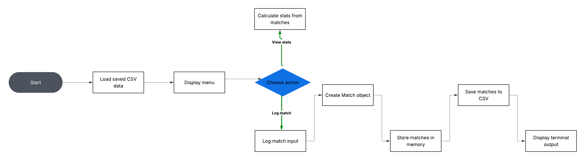

# Soccer Stats Tracker

A Java command-line tool for logging soccer players' match performances and viewing season stats.

## The Problem

I play indoor soccer on a weekly basis with a group of 10 - 15 friends. Currently, we don't keep track of any player or game stats. So, it's difficult to look back at previous games, evaluate player performances, or compare players' stats. 

## How It Works

Saved matches load from a CSV file when the program starts. From the menu, the user can log a new match (which is saved straight to the CSV) or view stats calculated from every match logged so far.

## Tech Stack

- **Language:** Java 17+
- **Standard libraries:** `java.io` (BufferedReader, FileWriter), `java.time` (LocalDate), `java.util`
- **Data storage:** CSV file (`data/matches.csv`)
- **Testing:** JUnit 5
- **Tools:** Git/GitHub, VS Code, draw.io (system diagram)

## Setup

## Example Run

## Roadmap

- [ ] Load saved matches from CSV
- [ ] Log matches through the terminal
- [ ] Save matches to CSV
- [ ] View past matches and player stats
- [ ] Calculate totals and averages
- [ ] Calculate streaks and advanced metrics (Schedule)
- [ ] JUnit tests for edge cases (Schedule)
- [ ] Data visualizations (Schedule)
- [ ] GUI instead of the terminal (Schedule)

## Demo